# Super Smash Bros. Melee (Raspberry Pi Source Port Release)

A high-performance, native source port of **Super Smash Bros. Melee** targeting the **Raspberry Pi** family (Pi Zero 2W, Pi Tin Handheld, and Raspberry Pi 4 / 400 / CM4) running **RetroPie** or **Raspberry Pi OS**.

Built upon the native C decompilation, this release delivers a custom multi-threaded OpenGL ES 2.0 and Mesa KMS/DRM rendering pipeline, low-latency UDP netplay, universal controller input, and complete stage visual accuracy.

---

## Screenshots

<div align="center">

### Title Screen & Combat Highlights
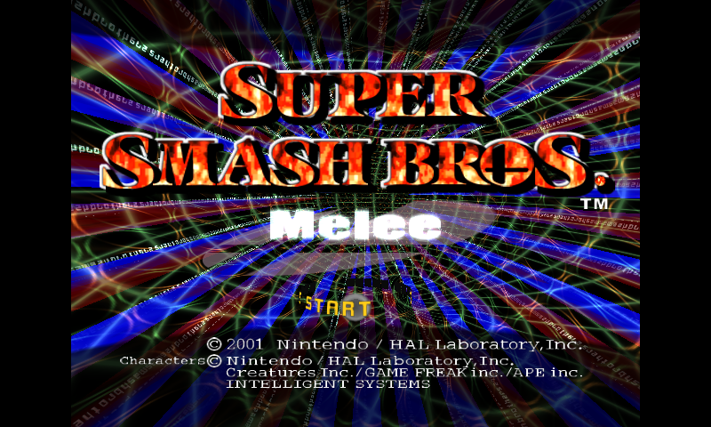

| Battlefield (4-Player Combat) | Final Destination |
| :---: | :---: |
| 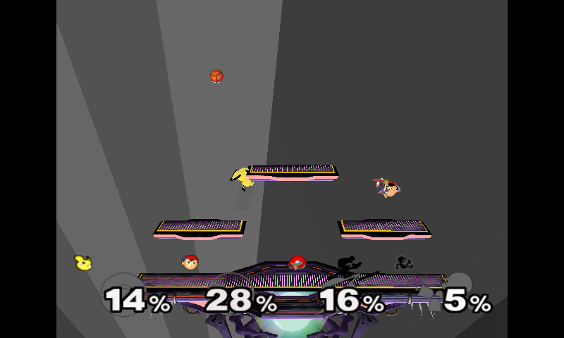 | 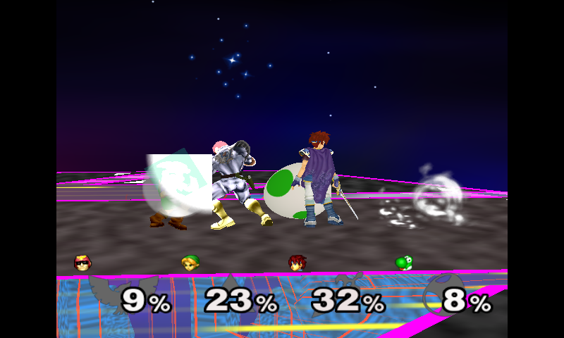 |

| Fountain of Dreams (Water Reflections) | Pokémon Stadium (Jumbotron Render Target) |
| :---: | :---: |
| 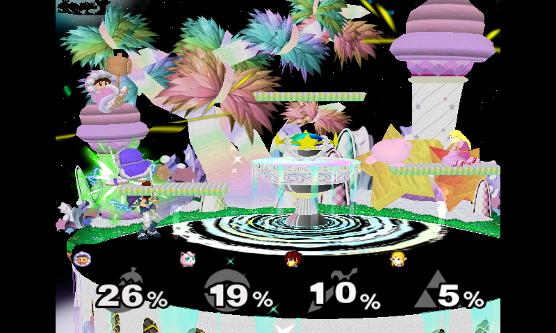 | 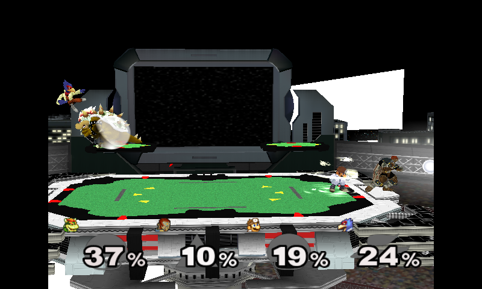 |

| Corneria (Great Fox Dogfight) | Mute City (Active Texcoord Road) |
| :---: | :---: |
| 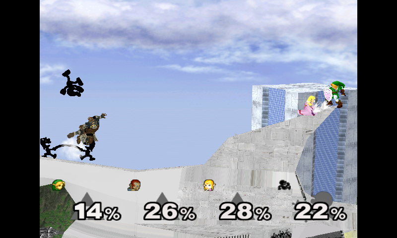 | 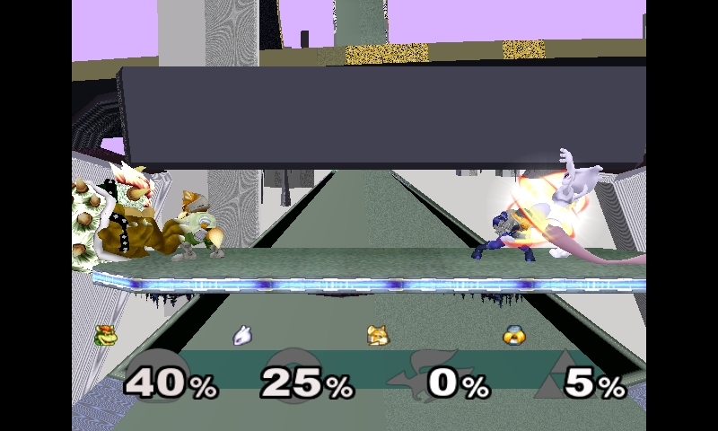 |

| Fourside (Skyscraper Facade Alpha) | Big Blue (High-Speed Track) |
| :---: | :---: |
| 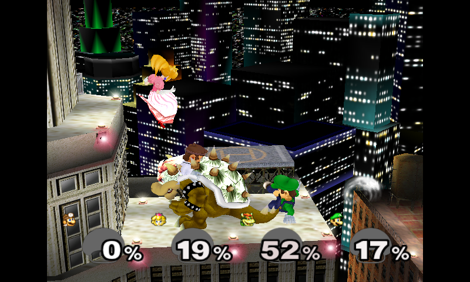 | 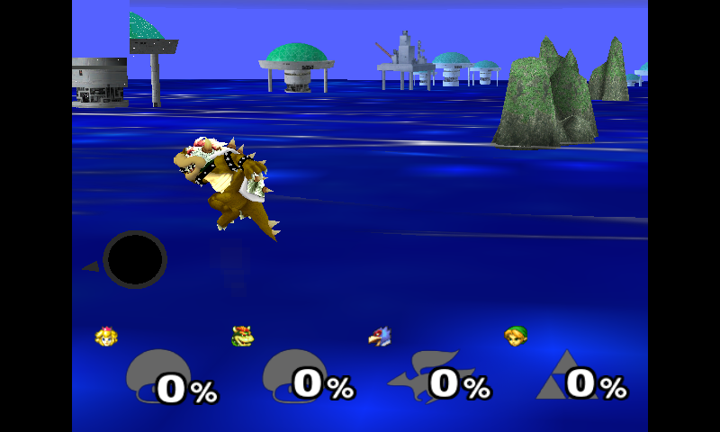 |

| Yoshi's Story | Pi Tin Handheld (320x240 SPI LCD) |
| :---: | :---: |
| 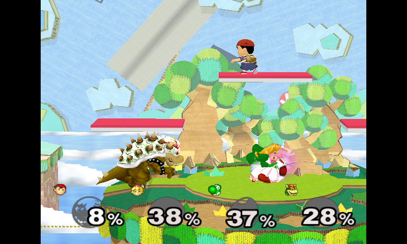 | 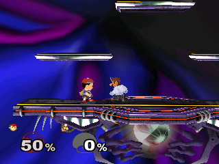 |

</div>

---

## Hardware Target Profiles

This release provides three standalone, pre-configured hardware patches:

| Profile | Hardware Target | Resolution | Target FPS | Video Backend | Input & Features |
| :--- | :--- | :--- | :--- | :--- | :--- |
| **Profile 1: Stock Zero 2W** | Raspberry Pi Zero 2W / Pi 3 | 320x240 / 640x480 | 50–60 FPS | DispmanX / EGL (Layer 10000) | Standard USB / BT Gamepads, HDMI out |
| **Profile 2: Pi Tin Handheld** | Pi Zero 2W in Mint Tin | 320x240 | 55–60 FPS | DispmanX (Layer 10010) | GPIOnext GPIO matrix, 2.8" SPI TFT LCD, Select+Start exit |
| **Profile 3: Raspberry Pi 4** | Pi 4B, 400, CM4 | 640x480 (480p) | Locked 60 FPS | Mesa KMS/DRM (vc4-kms-v3d) | 4-Player Local Couch, UDP Netplay, Cortex-A72 NEON |

---

## Key Features & Visual Engine Enhancements

- **Decoupled Asynchronous Multi-Threading**: Game simulation logic runs uninterrupted on Core 0/1 while a dedicated render thread dispatches OpenGL ES 2.0 commands on Cores 2 & 3.
- **Zero-Copy Direct Vertex Streaming**: Pre-transformed vertex arrays are streamed directly into unified GPU buffers, eliminating CPU memory copy bottlenecks.
- **O(1) TEV Combiner Caching**: Emulates the GameCube's fixed-function Texture Environment units with an indexed cache of optimized GLSL shader variants.
- **Complete Visual Stage Accuracy**:
  - *Mute City*: Active texcoord lookup table preserves animated track lights and scrolling road textures.
  - *Pokemon Stadium*: Jumbotron render target vertical inversion fix.
  - *Fourside*: Skyscraper facade transparency and window alpha test pass.
  - *Lupe Off-Screen Magnifier*: Bubble lens fallback texture prevents corrupted or missing off-screen player indicators.
  - *Multi-Texture Tinting*: Dual-texture additive blending and minimum-alpha rejection for special effect overlays and shields.
- **Low-Latency UDP Netplay**: Deterministic lockstep engine featuring automatic LAN broadcast beacon discovery (port 41000), a 2-frame input delay ring buffer, and redundant packet payload forward error correction (FEC).
- **EmulationStation Integration**: Automatic background ES freeze (`killall -STOP`) during gameplay to eliminate CPU contention and audio stuttering, with guaranteed restoration on exit.

---

## Legal & Intellectual Property Notice

> [!IMPORTANT]
> **NO NINTENDO GAME ASSETS ARE INCLUDED IN THIS RELEASE.**
> Super Smash Bros. Melee is copyright &copy; 2001 Nintendo / HAL Laboratory, Inc.
> 
> This distribution consists solely of open-source port code, patches, shell scripts, and configuration profiles. No copyrighted ROMs, ISOs, character models, music, sound effects, or proprietary binary DOLs are provided.
> 
> End-users must supply their own legitimately dumped GameCube disc image:
> - **Game Version**: Super Smash Bros. Melee (USA v1.02, `GALE01.iso`).
> - Place the disc image in your game directory as `game.iso`.

---

## Quick Start: Interactive Installation Assistant

The easiest way to install is using the included interactive assistant on your Raspberry Pi:

```bash
# Extract the release bundle on your Raspberry Pi
unzip melee_pi_github_release_v1.0.0.zip
cd release_melee_pi/scripts

# Run the installation assistant
chmod +x install.sh
./install.sh
```

The assistant will:
1. Detect your board model (Pi Zero 2W vs Pi 4).
2. Prompt you to select your preferred hardware profile.
3. Install required build dependencies via `apt`.
4. Clone upstream `melee-pc`, checkout verified commit `9d23d04`, and apply the selected patch.
5. Compile the native binary.
6. Install RetroPie launcher scripts to `/home/pi/RetroPie/roms/ports/`.
7. Prompt for your legal `game.iso`.

---

## Manual Installation Guide

If you prefer to build manually, follow these steps:

### 1. Prerequisites

On **Raspberry Pi Zero 2W / Pi 3** (Raspberry Pi OS 32-bit Buster/Bullseye):
```bash
sudo apt-get update
sudo apt-get install -y git cmake build-essential libsdl2-dev libraspberrypi-dev
```

On **Raspberry Pi 4 / 400 / CM4** (Raspberry Pi OS 32-bit or 64-bit):
```bash
sudo apt-get update
sudo apt-get install -y git cmake build-essential libsdl2-dev libgles2-mesa-dev libegl1-mesa-dev libdrm-dev libgbm-dev
```

### 2. Clone Upstream and Checkout Base Commit

The patches apply cleanly against upstream commit `9d23d04`:

```bash
git clone https://github.com/999sian/melee-pc.git melee_pi
cd melee_pi
git checkout 9d23d04a4867000f200f7c49a37a0f3fc2c09fd2
```

### 3. Apply Hardware Patch

Choose the patch matching your target device from the `patches/` folder:

- **Stock Pi Zero 2W**:
  ```bash
  git apply /path/to/release_melee_pi/patches/0001-melee-pi-zero2w-stock.patch
  ```
- **Pi Tin Handheld**:
  ```bash
  git apply /path/to/release_melee_pi/patches/0002-melee-pi-tin.patch
  ```
- **Raspberry Pi 4 / 400 / CM4**:
  ```bash
  git apply /path/to/release_melee_pi/patches/0003-melee-pi4.patch
  ```

### 4. Compile

```bash
mkdir -p build && cd build
cmake .. -DCMAKE_BUILD_TYPE=Release
cmake --build . -j$(nproc)
```

The compiled binary will be `./melee_pi` (or `./melee_pi4` for Pi 4).

### 5. Cross-Compilation (Optional: Build for Pi Zero 2W on x86_64 PC)

To cross-compile for ARM from an Ubuntu/Debian PC:
```bash
sudo apt-get install -y gcc-arm-linux-gnueabihf g++-arm-linux-gnueabihf
mkdir -p build-cross && cd build-cross
cmake .. \
    -DCMAKE_TOOLCHAIN_FILE=../cmake/armhf-toolchain.cmake \
    -DCMAKE_SYSROOT=/path/to/rpi-sysroot \
    -DTARGET_PI_ARM=1
cmake --build . -j$(nproc)
```

---

## RetroPie Ports Integration

Copy the corresponding launcher script from `scripts/` to `/home/pi/RetroPie/roms/ports/`:

- `Super Smash Bros Melee.sh` (Stock Pi Zero 2W)
- `Super Smash Bros Melee (Pi Tin).sh` (Pi Tin Handheld)
- `Super Smash Bros Melee (Pi 4 480p).sh` (Raspberry Pi 4)
- `Super Smash Bros Melee (LAN Host).sh` (Multiplayer Netplay Host)
- `Super Smash Bros Melee (LAN Join).sh` (Multiplayer Netplay Join)

Ensure executable permissions:
```bash
chmod +x /home/pi/RetroPie/roms/ports/*.sh
```

Place your GameCube disc image as:
```text
/home/pi/RetroPie/roms/ports/melee/game.iso
```

---

## Controls & Mapping

### Standard USB / Bluetooth Gamepads
Standard controllers (Xbox 360/One, DualShock 4, DualSense, 8BitDo, and Mayflash GameCube adapters) are automatically mapped via SDL2 GameController API. See `config/retroarch_gamecube_pad.cfg` for recommended RetroArch bindings.

### Pi Tin Handheld Controls
Pi Tin hardware controls use GPIOnext mapped directly to the GPIO header. Pre-configured mappings are provided in `config/gpionext_prow_pi_tin.json`.

### Universal Exit Hotkey
Because EmulationStation is frozen in the background, hold **Select + Start** (or **Hotkey + Start**) at any time to instantly and cleanly exit back to RetroPie.

---

## Low-Latency UDP Netplay

Two Raspberry Pis on the same local network (Wi-Fi or Ethernet) can play head-to-head with deterministic lockstep:

1. **Player 1 (Host)**: Launch `Super Smash Bros Melee (LAN Host).sh`. The host broadcasts discovery beacons on UDP port 41000.
2. **Player 2 (Join)**: Launch `Super Smash Bros Melee (LAN Join).sh`. The client automatically locates the host beacon and establishes the session.

### Direct IP Mode
If automatic discovery is blocked by network isolation, create a file named `peer_ip.txt` in your game folder containing the host's IP address:
```bash
echo "192.168.1.100" > /home/pi/RetroPie/roms/ports/melee/peer_ip.txt
```

---

## License

- Port code and modifications: **GPL-3.0-or-later** (see `LICENSE`).
- Original Melee reverse-engineering codebase: Copyright &copy; Nintendo / HAL Laboratory, Inc. (All rights reserved).
